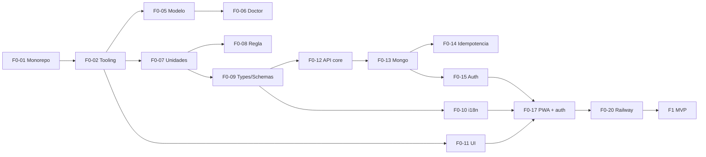

# Plan de accion — Sight Mapper

> Backlog ordenado por fases. Se detallan en tareas **F0 y F1** (la fase en curso y la siguiente);
> el resto son epicas que se desglosan al terminar la fase anterior (spec §15, regla de corte).
>
> Formato de tarea: `### [ ] Fx-NN · Titulo` — `[ ]` sin iniciar · `[~]` en proceso · `[x]` hecha ·
> `[!]` bloqueada · `[-]` cancelada. Puntos en Fibonacci (1 punto ≈ medio dia de trabajo enfocado).
> Toda tarea cumple el DoR antes de empezar y el DoD para cerrarse (spec §20).

---

## Estado

| Fase | Nombre            | Tareas | Puntos | Estado        |
| ---- | ----------------- | ------ | ------ | ------------- |
| F0   | Fundaciones       | 21     | 80     | sin iniciar   |
| F1   | MVP — Calculator  | 22     | 85     | sin iniciar   |
| F2   | MAKER             | epica  | —      | —             |
| F3   | Campo             | epica  | —      | —             |
| F4   | Offline-first     | epica  | —      | —             |
| F5   | Monetizacion      | epica  | —      | —             |
| F6   | Diferenciacion    | epica  | —      | —             |
| F7   | Salida al mercado | epica  | —      | —             |

Hecho fuera de tareas (2026-10-29): analisis, spec v1.0, documentos funcional y tecnico,
arquitectura, dominio, diccionario, errores, UX-UI, ADRs 000–011, este plan, bitacora y `CLAUDE.md`
raiz. Ver [BITACORA.md](BITACORA.md).

## Camino critico

---

# Fase 0 — Fundaciones

Objetivo: un monorepo que compila, testea y despliega; el dominio matematico completo y probado;
API y PWA esqueleto con login real en staging. **Sin features de negocio todavia.**

### [ ] F0-01 · Monorepo: pnpm + Turborepo + workspaces

- **Modulo:** repo · **Puntos:** 2 · **Depende de:** —
- **Descripcion:** `pnpm-workspace.yaml`, `turbo.json` (build, dev, lint, typecheck, test,
  test:coverage), `apps/{api,pwa}`, `packages/{domain,schemas,types,i18n,ui,client,config}` vacios
  con su `package.json` (`@sight-mapper/*`), `.nvmrc` (Node 22), `.npmrc`, `.gitignore`,
  `.gitattributes`, `.env.example`, `README.md`.
- **Criterios:**
  - Given un clon limpio, When corro `pnpm install && pnpm build`, Then termina sin errores.
  - Given `turbo run test`, Then cada paquete corre su suite (vacia) y pasa.
- **Errores nuevos:** — · **Datos:** —

### [ ] F0-02 · Tooling: TypeScript, ESLint, Prettier, husky, commitlint

- **Modulo:** repo · **Puntos:** 3 · **Depende de:** F0-01
- **Descripcion:** `packages/config` con tsconfig base `strict` (+ `noUncheckedIndexedAccess`,
  `exactOptionalPropertyTypes`), presets node/react. ESLint flat con reglas mecanizadas: fronteras
  de modulo (ADR-002), pureza de `domain` (sin I/O, `Date`, `Math.random`, `Temporal.Now`), sin
  `any`, sin `console`, `i18next/no-literal-string` en JSX. Prettier. husky + lint-staged.
  commitlint con los scopes de TECNICO §3.
- **Criterios:**
  - Given un import de `modules/equipment` desde `modules/calculator`, When corro `pnpm lint`,
    Then falla con la regla de fronteras.
  - Given `new Date()` en `packages/domain`, Then `pnpm lint` falla.
  - Given un commit `feat(foo): x` con scope inexistente, Then commitlint lo rechaza.
- **Errores nuevos:** — · **Datos:** —

### [ ] F0-03 · CLAUDE.md por app y `.claude/`

- **Modulo:** repo · **Puntos:** 3 · **Depende de:** F0-02
- **Descripcion:** `CLAUDE.md` raiz (ya creado) + uno por app. Agentes con rol cerrado:
  `spec-reviewer`, `domain-reviewer`, `security-reviewer`, `test-writer`. Comandos: `/adr`,
  `/bitacora`, `/new-task`, `/new-module`, `/trello-sync` (si hay tablero). Hooks: bloqueo de
  secretos en escritura, confirmacion al escribir en `docs/spec/**` y `packages/domain/src/**`,
  formato al editar.
- **Criterios:**
  - Given escribo un string con forma de API key en un archivo, Then el hook bloquea la escritura.
  - Given `/adr "titulo"`, Then se crea `docs/adr/NNN-titulo.md` desde la plantilla y se agrega al
    indice.
- **Errores nuevos:** — · **Datos:** —

### [!] F0-04 · Tablero de tareas

- **Modulo:** repo · **Puntos:** 1 · **Depende de:** — · **Bloqueada:** falta decidir si se usa
  Trello (u otro) y aprobar su creacion.
- **Descripcion:** tablero con listas `Sin iniciar / En proceso / Completadas / Canceladas /
  Bloqueadas`, una tarjeta por tarea de F0 y F1 con su ID, sincronizado con este archivo.
- **Criterios:** Given este plan, When corro la sincronizacion, Then cada tarea tiene su tarjeta en
  la lista de su estado y viceversa.

### [ ] F0-05 · `@sight-mapper/domain`: modelo de marcas

- **Modulo:** domain · **Puntos:** 8 · **Depende de:** F0-02
- **Descripcion:** TDD desde cero de [SIGHT-MATH.md](domain/SIGHT-MATH.md) §3–6 y §9:
  preprocesado, PCHIP (Fritsch–Carlson), parabola de minimos cuadrados centrada, extrapolacion
  anclada con limite de vertice y baja confianza, calculo escalonado 2/3/5, grilla de intermedias
  desde el origen, consulta libre, `outOfScale`. Resultados discriminados (sin excepciones para
  casos del arquero). Tests de propiedades con `fast-check`.
- **Criterios:**
  - Given marcas `(20, 15), (30, 20), (40, 35), (50, 45), (60, 60)` (mm), When pido `markAt(d_i)`,
    Then devuelve exactamente `m_i` para las cinco.
  - Given cualquier conjunto monotono generado por `fast-check`, Then la funcion es monotona y
    acotada entre marcas consecutivas.
  - Given 2 marcas, When pido una distancia fuera del rango, Then el resultado es
    `{ ok: false, code: 'SM-CALC-422-002' }`.
  - Given 3+ marcas, When pido `d_max + 1`, Then `f` es continua en `d_max` (diferencia < 1e-9 en el
    limite) y `kind = 'extrapolated'`.
  - Cobertura ≥ 95%.
- **Errores nuevos:** `SM-CALC-422-001/002/004/005` · **Datos:** —

### [ ] F0-06 · `@sight-mapper/domain`: Mark Doctor

- **Modulo:** domain · **Puntos:** 5 · **Depende de:** F0-05, F0-21
- **Descripcion:** monotonia por direccion de escala (desde 2 marcas) y residuos leave-one-out con
  umbral robusto (desde 5), segun SIGHT-MATH §7–8. Calibracion inicial de `DOCTOR_K`,
  `DOCTOR_MIN_ABS_MM`, `DOCTOR_ENDPOINT_FACTOR` con los fixtures reales (F0-21).
- **Criterios:**
  - Given los sets reales del autor marcados como buenos, Then `status = 'ok'` en todos.
  - Given un set bueno con +1 unidad de escala inyectada en una marca interior, Then esa marca es
    `suspect` y es la peor.
  - Given `direction = 'down'` y una marca mas lejana con lectura menor, Then `status =
    'inconsistent'` con ambas marcas.
- **Errores nuevos:** `SM-CALC-422-003` · **Datos:** —

### [ ] F0-07 · `@sight-mapper/domain`: unidades

- **Modulo:** domain · **Puntos:** 5 · **Depende de:** F0-02
- **Descripcion:** `convert/` segun [UNIDADES.md](domain/UNIDADES.md): constantes exactas, m↔yd,
  lectura↔mm por `SightScale`, equipo (mm, g, m/s, N ↔ presentacion), quantum en aritmetica entera,
  parser de numeros con coma/punto y fracciones imperiales, formateo de decimales por quantum.
- **Criterios:**
  - Given `20 yd`, Then `18.288 m` exacto.
  - Given escala `custom` 1–9 con `unitSizeMm = 10`, When convierto `3.5`, Then `35 mm`, y vuelta
    `3.5`.
  - Given `"6 1/4"` en imperial, Then `6.25 in` → `158.75 mm`.
  - Test no negociable #6 (ida y vuelta) con `fast-check` en m/yd y en las cinco unidades.
- **Errores nuevos:** — · **Datos:** —

### [ ] F0-08 · `@sight-mapper/domain`: regla

- **Modulo:** domain · **Puntos:** 3 · **Depende de:** F0-07
- **Descripcion:** `ruler/` segun SIGHT-MATH §10: niveles de tick por unidad en enteros, posicion
  segun `direction`, guarda de densidad (4 px), anti-solape con linea guia.
- **Criterios:**
  - Given escala `mm` 0–120 en 600 px, Then hay ticks mayores cada 10 mm exactos (sin deriva
    flotante en el ultimo).
  - Given 240 px para 0–120 mm, Then los ticks de 1 mm no se generan (densidad).
  - Given dos marcas a 2 px, Then sus etiquetas no se superponen y conservan su `y` real.
- **Errores nuevos:** — · **Datos:** —

### [ ] F0-09 · `@sight-mapper/types` y `@sight-mapper/schemas`

- **Modulo:** types, schemas · **Puntos:** 3 · **Depende de:** F0-07
- **Descripcion:** enums ([DICCIONARIO](DICCIONARIO.md) §5), catalogo de errores tipado generado de
  [errors.md](errors.md) (`ErrorCode`, `messageKey`), schemas Zod 4 de todas las entidades y DTOs
  (crear, editar, listar, cursor), validacion de UUIDv7, rangos canonicos del diccionario.
- **Criterios:**
  - Given un `AppError('SM-XXX-999-999')`, Then no compila.
  - Given `scale.min ≥ scale.max`, Then el schema de mira falla con `issues` en `scale.max`.
- **Errores nuevos:** todos los de errors.md §4.1–4.6 quedan tipados · **Datos:** —

### [ ] F0-10 · `@sight-mapper/i18n`

- **Modulo:** i18n · **Puntos:** 2 · **Depende de:** F0-09
- **Descripcion:** catalogos `es`/`en` por namespace, tipos de claves, helper de formateo
  (`Intl`), test de paridad y test de "todo codigo de error tiene clave".
- **Criterios:**
  - Given una clave que existe en `es` y no en `en`, Then el test falla.
  - Given `t('no.existe')`, Then no compila.

### [ ] F0-11 · `@sight-mapper/ui`: tokens y primitivas

- **Modulo:** ui · **Puntos:** 5 · **Depende de:** F0-02
- **Descripcion:** tokens dark (del diseño) y light (alto contraste) segun [UX-UI.md](UX-UI.md) §2;
  primitivas: `Button`, `Field`, `NumberField`, `PasswordField`, `Segmented`, `Select`,
  `SectionCard`, `AppHeader`, `NavDrawer`, `BottomSheet`, `Toast` con deshacer, `InfoAlert`,
  `StatusBadge`, `EmptyState`, `ErrorState`, `Skeleton`, `UpdatePrompt`. Tocables ≥ 44 px.
  Catalogo visual (pagina de sandbox en la PWA en dev).
- **Criterios:**
  - Given cualquier primitiva interactiva, Then su area tocable mide ≥ 44×44 px (test).
  - Given ambos temas, Then los pares texto/fondo pasan AA (test de contraste sobre tokens).

### [ ] F0-12 · `apps/api`: nucleo HTTP

- **Modulo:** api/core · **Puntos:** 5 · **Depende de:** F0-09
- **Descripcion:** Hono, env validado con Zod, `AppError` + error middleware + envelope,
  `requestId`, Pino con redaccion, headers de seguridad, CORS explicito, limite de body, `/health`,
  `/ready`, registro de rutas con OpenAPI generado, bus de eventos in-process,
  `composition-root.ts`.
- **Criterios:**
  - Given una ruta que lanza un `Error` cualquiera, Then responde `SM-CORE-500-001` sin stack y loguea
    `error` con stack y `requestId`.
  - Given Mongo caido, Then `/health` 200 y `/ready` 503 `SM-CORE-503-001`.
  - Given un body de 100 KB, Then `SM-CORE-413-001`.
- **Errores nuevos:** CORE 400/401/404/413/415/500/503 · **Datos:** —

### [ ] F0-13 · `apps/api`: MongoDB, migraciones y aislamiento

- **Modulo:** api/core · **Puntos:** 5 · **Depende de:** F0-12
- **Descripcion:** conexion Mongoose, helper `withTransaction`, `migrate-mongo` con indices de
  [DICCIONARIO](DICCIONARIO.md) §4, plugin de aislamiento y de soft delete, traductor
  `Temporal ⇄ Date`, `mongodb-memory-server` en replset para tests. Verificar indices parciales con
  `deletedAt: { $type: 'null' }`.
- **Criterios:**
  - Given una query sin `userId`, Then lanza `SM-CORE-500-002`.
  - Given dos documentos con mismo `(userId, setupId, arrowSetId, distanceM)` y uno borrado, Then el
    indice unico parcial lo permite; dos activos, no.
  - Given `pnpm migrate up` dos veces, Then la segunda no hace nada.
- **Errores nuevos:** `SM-CORE-500-002` · **Datos:** indices de todas las colecciones

### [ ] F0-14 · `apps/api`: idempotencia y concurrencia

- **Modulo:** api/core · **Puntos:** 3 · **Depende de:** F0-13
- **Descripcion:** middleware `Idempotency-Key` (coleccion con TTL), `ETag`/`If-Match` con
  `version`, validacion de `id` UUIDv7 en `POST`.
- **Criterios:**
  - Test no negociable #3: mismo `POST` + misma clave ×3 → 1 documento, 3 respuestas iguales.
  - Misma clave + otro cuerpo → `SM-CORE-409-001`.
  - Test no negociable #7: `PATCH` con version vieja → `SM-CORE-412-001`; sin `If-Match` →
    `SM-CORE-428-001`.
- **Errores nuevos:** `SM-CORE-400-002`, `409-001/002`, `412-001`, `428-001` · **Datos:**
  `idempotencyKeys`

### [ ] F0-15 · `apps/api`: Better Auth

- **Modulo:** api/auth, account · **Puntos:** 5 · **Depende de:** F0-13
- **Descripcion:** Better Auth con adaptador Mongo: email+password, `username`, Google,
  verificacion (Resend, plantillas ES/EN), reset, rate limit, cookies, middleware de sesion →
  `ctx.userId`, mapeo de errores a `SM-AUTH-*`, evento `UserRegistered` → `Profile`.
- **Criterios:**
  - Given registro valido, Then se crea `user` y `profile`, y se envia el email (mock en test).
  - Given login con username o con email, Then ambos funcionan; sin verificar → `SM-AUTH-403-001`.
  - Given 6 intentos fallidos, Then `SM-CORE-429-001`.
  - Given un log de login, Then no contiene la contraseña ni el token.
- **Errores nuevos:** `SM-AUTH-*`, `SM-CORE-429-001` · **Datos:** `user`, `session`, `account`,
  `verification`, `profiles`

### [ ] F0-16 · Suite de aislamiento y scheduler de jobs

- **Modulo:** api · **Puntos:** 3 · **Depende de:** F0-14, F0-15
- **Descripcion:** suite parametrizada sobre el registro de rutas (test no negociable #1) +
  scheduler in-process con lock en `jobLocks`, registro en `jobRuns`, primer job
  `purgeIdempotencyKeys`.
- **Criterios:**
  - Given una ruta registrada sin fixture de ataque, Then la suite falla.
  - Given dos instancias del scheduler, Then el job corre una sola vez por ventana.

### [ ] F0-17 · `apps/pwa`: esqueleto y pantallas de auth

- **Modulo:** pwa · **Puntos:** 8 · **Depende de:** F0-10, F0-11, F0-15, F0-18
- **Descripcion:** Vite + React 19, TanStack Router (rutas de FUNCIONAL §1.1 como placeholders),
  Query, i18n, tema (dark/light/system), `vite-plugin-pwa` (manifest, iconos Sight Mapper, prompt de
  actualizacion, version visible), error boundary por ruta. Pantallas: splash, sign-in (email o
  username, Google, recupero), sign-up, forgot, reset, verify. Guard de rutas autenticadas.
- **Criterios:**
  - Given la PWA en Chrome Android, Then es instalable (Lighthouse PWA).
  - Given un deploy nuevo, Then aparece "Hay una version nueva · Actualizar".
  - Given registro → verificacion → login, Then llego al Home vacio (E2E smoke).
  - ES y EN completos en estas pantallas.

### [ ] F0-18 · `@sight-mapper/client`

- **Modulo:** client · **Puntos:** 3 · **Depende de:** F0-09, F0-12
- **Descripcion:** cliente `fetch` tipado con `ApiError`, `credentials: 'include'`,
  `Idempotency-Key` automatica en `POST`, `If-Match` desde la version en cache, timeout 10 s,
  errores `NET-*`, politica de reintentos, factory de hooks de Query inyectable.
- **Criterios:**
  - Given una respuesta 409 con envelope, Then se lanza `ApiError` con `code` y `params`.
  - Given red caida, Then `SM-NET-503-001`.
- **Errores nuevos:** `SM-NET-*`

### [ ] F0-19 · CI en GitHub Actions

- **Modulo:** ci · **Puntos:** 3 · **Depende de:** F0-02
- **Descripcion:** workflow de TECNICO §11 con gates de cobertura por zona, Lighthouse CI (cuando
  exista la PWA), escaneo de dependencias/licencias/secretos, template de PR con checklist del DoD.
- **Criterios:** Given un PR que baja la cobertura de `domain` a 94%, Then el CI falla.

### [!] F0-20 · Railway (staging + prod), Atlas y dominio

- **Modulo:** infra · **Puntos:** 3 · **Depende de:** F0-15, F0-17 · **Bloqueada:** dominio (spec
  §17.1) y consola de Google OAuth.
- **Descripcion:** proyecto Railway con servicios `api` y `pwa` por entorno, `railway.json`,
  variables, healthcheck `/ready`, migraciones como paso de release; clusters Atlas `staging` y
  `prod` (backups + PITR); DNS; monitor externo de uptime.
- **Criterios:**
  - Given un merge a `main`, Then staging se despliega solo y `/ready` responde 200.
  - Given prod, Then solo se despliega por promocion manual.
- **Errores nuevos:** — · **Datos:** clusters

### [ ] F0-21 · Fixtures de datos reales del autor

- **Modulo:** domain (tests) · **Puntos:** 2 · **Depende de:** —
- **Descripcion:** extraer de los proyectos previos (SQLite de `bv-bow-sight`) los sets de marcas
  reales a JSON en `packages/domain/test/fixtures/` (solo distancia, lectura, escala; sin datos
  personales), con la etiqueta "bueno/dudoso" que indique el autor. Es **dato**, no codigo portado.
- **Criterios:** Given los fixtures, Then el autor confirmo cuales sets son buenos.

---

# Fase 1 — MVP: Calculator

Objetivo: un arquero real reemplaza el papelito. Todo [spec §4.1](spec/SIGHT-MAPPER-SPEC.md).

### [ ] F1-01 · Preferencias y Apariencia

- **Modulo:** account, pwa · **Puntos:** 3 · **Depende de:** F0-17
- **Descripcion:** `GET /me`, `PATCH /me/preferences`; pantalla Apariencia (tema, idioma,
  unidades). Cambio instantaneo sin recargar.
- **Criterios:** HU-ACC-04 (FUNCIONAL §3.1).
- **Errores nuevos:** — · **Datos:** `profiles`

### [ ] F1-02 · Arcos (compuesto)

- **Modulo:** equipment/bows, pwa · **Puntos:** 5 · **Depende de:** F0-16, F0-17
- **Descripcion:** API completa (TECNICO §5.3), listado, detalle, form de `New bow — Full form.png`
  con unidades por sistema, archivar/desarchivar, borrado protegido via `ComponentUsagePort`
  (stub hasta F1-05).
- **Criterios:** HU-BOW-01, HU-EQP-01. Aislamiento incluido.
- **Errores nuevos:** `SM-BOW-409-001`, `SM-BOW-422-001` · **Datos:** `bows`

### [ ] F1-03 · Miras con escala nativa

- **Modulo:** equipment/sights, pwa · **Puntos:** 8 · **Depende de:** F1-02
- **Descripcion:** API + form de mira redefinido (UX-UI §4.4): unidad, tamaño de unidad (o largo
  fisico entre min y max), min, max, resolucion, direccion, tipo de pin; vista previa de la regla.
  Cambio de escala con estrategia (`SightMarksPort`, transaccional).
- **Criterios:** HU-SGT-01, HU-SGT-02. Test no negociable #5.
- **Errores nuevos:** `SM-SGT-409-001/002/003`, `SM-SGT-422-001` · **Datos:** `sights`

### [ ] F1-04 · Sets de flechas

- **Modulo:** equipment/arrows, pwa · **Puntos:** 3 · **Depende de:** F1-02
- **Descripcion:** API + listado + form de `New arrow set — Form.png` con seccion "Mas datos".
- **Criterios:** HU-ARW-01, HU-EQP-01.
- **Errores nuevos:** `SM-ARW-409-001` · **Datos:** `arrowSets`

### [ ] F1-05 · Setups, Home y papelera

- **Modulo:** calculator/setups, pwa · **Puntos:** 8 · **Depende de:** F1-03, F1-04
- **Descripcion:** API de setups (TECNICO §5.4), implementacion real de `ComponentUsagePort` y
  `EquipmentReadPort`, Home (`Home — Your sets.png` como "Your setups") con favoritos, New setup con
  multiseleccion de flechas y "+ cargar nuevo", editar setup, papelera con restaurar, job
  `purgeDeletedSetups`.
- **Criterios:** HU-STP-01, HU-STP-02, HU-STP-04. Test no negociable #4.
- **Errores nuevos:** `SM-STP-*` · **Datos:** `setups`

### [ ] F1-06 · Menu lateral

- **Modulo:** pwa · **Puntos:** 2 · **Depende de:** F1-05
- **Descripcion:** `NavDrawer` del diseño: contadores de arcos/miras/flechas, Statistics
  deshabilitado "Proximamente", Profile, Appearance, Papelera, Log out, ultima sincronizacion.
- **Criterios:** contadores correctos; Statistics no navega; foco atrapado y cierre con Escape.

### [ ] F1-07 · Marcas: API

- **Modulo:** calculator/manual · **Puntos:** 5 · **Depende de:** F1-05
- **Descripcion:** crear, editar, borrar, restaurar; `replace: true`; validacion transaccional de
  escala y de pertenencia del set de flechas; listado por par (tope 500).
- **Criterios:** HU-MRK-01..03 del lado API. Aislamiento + idempotencia + escritura obsoleta.
- **Errores nuevos:** `SM-MARK-*` · **Datos:** `marks`

### [ ] F1-08 · Pantalla de la mira

- **Modulo:** pwa (sight) · **Puntos:** 8 · **Depende de:** F1-07, F0-08
- **Descripcion:** segun `UV slider — Full marks.png` y UX-UI §4.2: readout, selector de flechas,
  herramientas (Wind/Weather "Proximamente", Doctor por tier, Print), `Ruler` SVG + `MarksTable`
  sincronizadas, leyenda, estado vacio, `StatusBar`, estado en URL (`arrowSet`, `d`), tabla como
  alternativa accesible.
- **Criterios:** HU-MRK-04. Calculo de 50 marcas < 16 ms (RNF-02).

### [ ] F1-09 · Hoja de nueva/editar marca

- **Modulo:** pwa (sight) · **Puntos:** 5 · **Depende de:** F1-08
- **Descripcion:** `BottomSheet` con distancia (unidad del arquero) y lectura (escala de la mira),
  stepper ± quantum, teclado numerico, nota y fecha; guardado optimista con deshacer; dialogo de
  reemplazo ante `SM-MARK-409-001`; manejo de 412.
- **Criterios:** HU-MRK-01, HU-MRK-02, HU-MRK-03. Guardado percibido < 100 ms.

### [ ] F1-10 · Intermedias, curva y consulta libre

- **Modulo:** pwa (distances) · **Puntos:** 5 · **Depende de:** F1-08, F0-05
- **Descripcion:** segun `Calculate distances — Curve.png`: desde/hasta/paso (1/2/5/10, en m o yd),
  tabla, `DistanceCurve` (solido vs punteado), consulta libre ("Get reading"), avisos de tier, baja
  confianza y fuera de escala.
- **Criterios:** HU-CAL-01, HU-CAL-02, HU-CAL-03.

### [ ] F1-11 · Mark Doctor

- **Modulo:** pwa (doctor) · **Puntos:** 3 · **Depende de:** F1-08, F0-06
- **Descripcion:** pantalla del Doctor (sin diseño previo: boceto en la tarea), residuos por marca,
  marca sospechosa con magnitud en escala de la mira y "Volve a tirar", avisos de monotonia en
  regla y tabla desde 2 marcas.
- **Criterios:** HU-CAL-04.

### [ ] F1-12 · Sistema imperial completo

- **Modulo:** pwa, domain · **Puntos:** 3 · **Depende de:** F1-02..F1-10
- **Descripcion:** cerrar la decision abierta §17.2 (unidades de equipo por sistema) con 2–3
  arqueros, aplicar en todos los forms y vistas, fracciones en la entrada.
- **Criterios:** recorrer el flujo critico entero en imperial sin ver una unidad metrica.

### [ ] F1-13 · Ingles completo

- **Modulo:** i18n, pwa · **Puntos:** 3 · **Depende de:** F1-11
- **Descripcion:** revision de todos los textos EN (tono de producto, terminos de arqueria en
  ingles), formatos por locale, emails EN.
- **Criterios:** recorrer el flujo critico en EN sin un string en español; test de paridad verde.

### [ ] F1-14 · Listado imprimible

- **Modulo:** pwa (print) · **Puntos:** 3 · **Depende de:** F1-10
- **Descripcion:** ruta `/setups/:id/print` con CSS de impresion: encabezado, tabla con paso
  elegido, `≈` y nota al pie para estimados, legible en B/N.
- **Criterios:** HU-CAL-05; "Guardar como PDF" en Chrome y Safari produce una hoja A4/Letter sin
  cortes.

### [ ] F1-15 · Acceso rapido

- **Modulo:** account, pwa · **Puntos:** 2 · **Depende de:** F1-08
- **Descripcion:** `PUT /me/quick-access`, accion "Abrir siempre aca", redireccion al boot, limpieza
  al borrar el setup (evento `SetupDeleted`).
- **Criterios:** HU-STP-03.
- **Errores nuevos:** `SM-ACC-422-001`

### [ ] F1-16 · Perfil: exportar datos y baja

- **Modulo:** account, pwa · **Puntos:** 3 · **Depende de:** F1-07
- **Descripcion:** pantalla Perfil (username, email, version de la app), `GET /me/export`, pedir y
  cancelar la baja, job `purgeDeletedAccounts` con `UserDataPurgePort`.
- **Criterios:** HU-ACC-05, HU-ACC-06 (con reloj inyectado).
- **Errores nuevos:** `SM-ACC-404-001`, `SM-ACC-409-001`

### [ ] F1-17 · Onboarding de primer uso

- **Modulo:** pwa · **Puntos:** 3 · **Depende de:** F1-05, F1-09
- **Descripcion:** checklist de FUNCIONAL §2.1 en el Home vacio, preseleccion de lo recien cargado.
- **Criterios:** un usuario nuevo llega a su primera marca sin salir de la guia (E2E).

### [ ] F1-18 · Tema light verificado

- **Modulo:** ui, pwa · **Puntos:** 2 · **Depende de:** F1-11
- **Descripcion:** pasar todas las pantallas por el tema light de alto contraste; prueba al sol con
  un telefono real.
- **Criterios:** contraste AA en ambos temas; screenshots de referencia dark/light por pantalla.

### [ ] F1-19 · Accesibilidad y responsive

- **Modulo:** pwa · **Puntos:** 3 · **Depende de:** F1-11
- **Descripcion:** auditoria axe + teclado + lector de pantalla en el flujo critico; layouts 768 y
  1440 (UX-UI §7).
- **Criterios:** 0 violaciones axe serias; flujo critico completo con teclado; 360/768/1440 sin
  desbordes.

### [ ] F1-20 · E2E del flujo critico

- **Modulo:** e2e · **Puntos:** 3 · **Depende de:** F1-17
- **Descripcion:** Playwright (movil 360 y desktop): registro → equipo → setup → 5 marcas →
  intermedias → Doctor → imprimir; idem en EN + imperial.
- **Criterios:** verde en CI sobre staging.

### [ ] F1-21 · Importar los datos reales del autor (opcional)

- **Modulo:** scripts · **Puntos:** 2 · **Depende de:** F1-07
- **Descripcion:** script one-off que importa al entorno de prod los setups y marcas reales del
  autor desde los proyectos previos, via la API (respeta todas las reglas).
- **Criterios:** el autor ve sus setups con las mismas lecturas que tenia.

### [ ] F1-22 · Release del MVP y prueba con arqueros

- **Modulo:** infra, producto · **Puntos:** 3 · **Depende de:** todo F1
- **Descripcion:** promocion a prod, restore de backup probado en staging, script de metricas
  agregadas desde la base (spec §2, sin tracking de terceros), prueba con 5–10 arqueros (CBA, liga
  bahiense), canal de feedback.
- **Criterios:** metricas de activacion medidas a los 14 dias; issues de feedback triados en este
  plan.

---

# Fases siguientes (epicas)

Se desglosan en tareas al cerrar la fase anterior.

### F2 — MAKER

- **F2-A** Geometria del tape en `domain/maker` (ADR-011 pasa a Aceptada).
- **F2-B** PDF en el cliente a escala real con barra de 100 mm.
- **F2-C** Calibracion de impresora por usuario.
- **F2-D** Editor de forma y tamaño (desktop) sin alterar la escala.
- **F2-E** Modulo `maker` en la API (diseños guardados, factor de impresora).

### F3 — Campo

- **F3-A** Corte por angulo con inclinometro (permisos iOS) y entrada manual.
- **F3-B** Presets de rondas: WA 70/50, sala 18/25, NFAA Field/Hunter, 3D.
- **F3-C** Wind / Weather: correccion manual por sesion (vertical y deriva).
- **F3-D** Deriva por marca.
- **F3-E** Recurvo (`bowType: recurve`, campos propios).

### F4 — Offline-first

- **F4-A** Cola de mutaciones persistida (IndexedDB) en `client`.
- **F4-B** Sincronizacion y reintentos con la idempotencia existente.
- **F4-C** Resolucion de conflictos 412 en la UI.
- **F4-D** Estado de sincronizacion visible (el "Synced 2 min ago" del diseño).

### F5 — Monetizacion y landing

- **F5-A** Entitlements: catalogo de planes, middleware, estado `locked` de miras.
- **F5-B** Pasarelas detras de adaptador (decidir Merchant of Record).
- **F5-C** Trial, dunning, gracia, reconciliacion.
- **F5-D** `apps/landing` prerenderizada con precios.

### F6 — Diferenciacion

- **F6-A** Semilla balistica (RK4 + busqueda binaria), `origin: seeded`.
- **F6-B** Motor de condiciones aprendido.
- **F6-C** Comparar sets de flechas superpuestos.
- **F6-D** Historial de cambios de marcas.
- **F6-E** Compartir con coach (lectura).
- **F6-F** Statistics (definir alcance sin caer en scoring, fuera de alcance).

### F7 — Salida al mercado

- **F7-A** Landing auditada y SEO. **F7-B** Legales. **F7-C** Sentry y analytics cookieless.
  **F7-D** Backups con restore probado. **F7-E** Lanzamiento: CBA y liga bahiense, luego
  ArcheryTalk y r/Archery.
