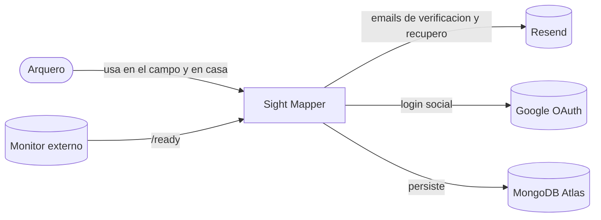
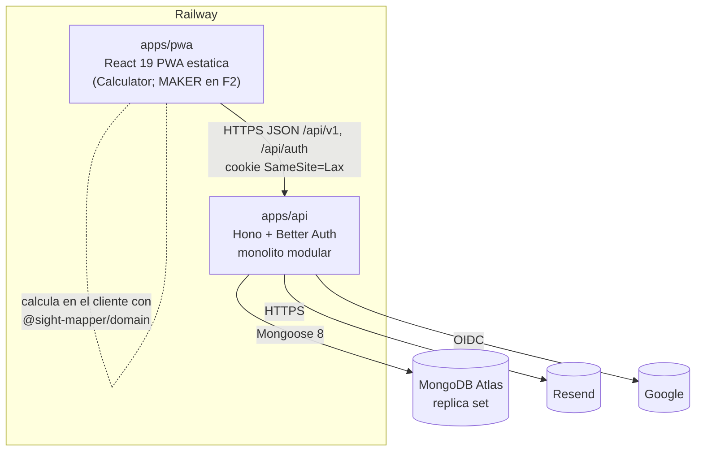
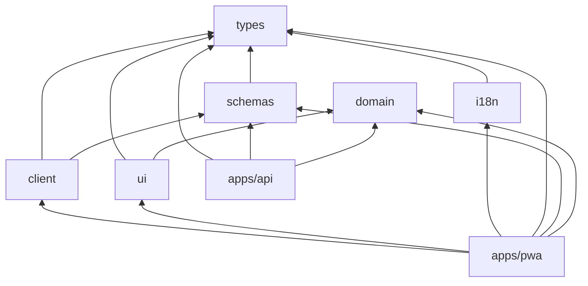
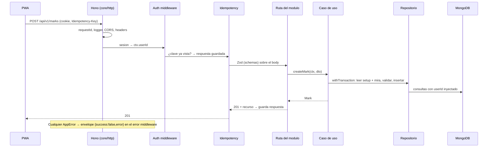
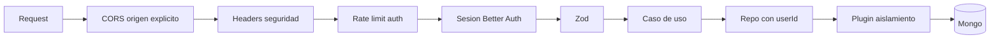

# Arquitectura — Sight Mapper

> Estructura del sistema, fronteras y reglas de dependencia. El "como se construye" (stack,
> endpoints, CI/CD) esta en [TECNICO.md](TECNICO.md); el modelo, en [DOMINIO.md](DOMINIO.md).

---

## 1. Contexto (C4 nivel 1)



## 2. Contenedores (C4 nivel 2)



Decisiones estructurales:

- **El calculo corre en el cliente.** `@sight-mapper/domain` es puro y lo importa la PWA: la curva,
  las intermedias y el Doctor responden al instante y siguen andando sin señal (base de F4). La API
  **valida y persiste**; no calcula. → [ADR-001](adr/001-empirical-first.md)
- **Dos apps en el MVP.** La landing es F5. MAKER (F2) es una seccion de la PWA con layout desktop,
  no una app aparte.
- **Monolito modular** en la API: un solo deploy, fronteras de modulo duras. →
  [ADR-002](adr/002-monorepo-modular-monolith.md)

## 3. Monorepo

```
sight-mapper-archery-project/
├─ apps/
│  ├─ api/                 Hono + Better Auth + Mongoose
│  └─ pwa/                 React 19 + TanStack + vite-plugin-pwa
├─ packages/
│  ├─ domain/              math puro: modelo, doctor, unidades, regla (sin dependencias)
│  ├─ schemas/             Zod 4 compartido front/back (DTOs, validaciones)
│  ├─ types/               tipos compartidos: codigos de error, estados, enums
│  ├─ i18n/                catalogos ES/EN con claves tipadas
│  ├─ ui/                  design system: tokens, primitivas, Ruler
│  ├─ client/              cliente HTTP tipado + hooks de TanStack Query
│  └─ config/              tsconfig, ESLint, Prettier, Vitest presets
├─ e2e/                    Playwright
├─ docs/                   esta documentacion
└─ .claude/                agentes, comandos y hooks
```

### 3.1 Grafo de dependencias permitido



- `domain` no depende de **nada** (ni de `types`): es la pieza mas estable.
- Ningun paquete depende de una app. `ui` no conoce `client` (se le inyectan datos).
- Lo verifica ESLint (`import/no-restricted-paths` + `boundaries`) y lo valida el CI.

## 4. API: monolito modular

```
apps/api/src/
├─ main.ts                    arranque
├─ composition-root.ts        cablea modulos, puertos y eventos
├─ core/                      kernel compartido (no es un modulo de negocio)
│  ├─ http/                   app Hono, envelope, error middleware, requestId, CORS, headers
│  ├─ auth/                   Better Auth + middleware de sesion
│  ├─ db/                     conexion, transacciones, plugin de aislamiento, migraciones
│  ├─ idempotency/            middleware Idempotency-Key
│  ├─ concurrency/            If-Match / version
│  ├─ events/                 bus in-process
│  ├─ jobs/                   scheduler con lock en Mongo
│  ├─ logger/                 Pino
│  └─ registry/               registro de rutas (OpenAPI + suite de aislamiento)
└─ modules/
   ├─ account/   {domain, application, infrastructure}
   ├─ equipment/ {domain, application, infrastructure}   bows, sights, arrows
   └─ calculator/{domain, application, infrastructure}   setups, marks
```

### 4.1 Capas de un modulo

| Capa             | Contiene                                                | Puede importar                                  |
| ---------------- | ------------------------------------------------------- | ----------------------------------------------- |
| `domain/`        | Entidades, value objects, reglas, errores, puertos      | `@sight-mapper/domain`, `@sight-mapper/types`   |
| `application/`   | Casos de uso (un archivo por caso), DTOs de entrada     | su `domain/`, `schemas`, `core/events`          |
| `infrastructure/`| Repositorios Mongoose, rutas Hono, adaptadores de puertos | su `application/` y `domain/`, `core/*`       |

Reglas mecanizadas (ESLint):

1. `domain/` no importa Mongoose, Hono, Better Auth ni `core/`.
2. Un modulo **no importa nada** de otro modulo. Se habla por puertos o eventos.
3. Una ruta no toca un modelo de Mongoose: solo casos de uso.
4. Un repositorio recibe `userId` en el constructor (contexto de request) y lo inyecta en toda
   consulta.

### 4.2 Puertos entre modulos

| Puerto                | Lo declara  | Lo implementa | Para que                                                   |
| --------------------- | ----------- | ------------- | ---------------------------------------------------------- |
| `EquipmentReadPort`   | calculator  | equipment     | Existencia/estado de componentes y escala de la mira       |
| `ComponentUsagePort`  | equipment   | calculator    | Contar setups/marcas que usan un componente (borrado protegido) |
| `SightMarksPort`      | equipment   | calculator    | Leer y reescribir marcas de una mira al cambiar la escala (misma transaccion) |
| `UserDataExportPort`  | account     | equipment, calculator | Exportar todo lo del usuario                       |
| `UserDataPurgePort`   | account     | equipment, calculator | Purgar todo lo del usuario                         |

### 4.3 Flujo de una request



## 5. PWA

```
apps/pwa/src/
├─ app/            providers (Query, i18n, theme, router), layout, UpdatePrompt
├─ routes/         TanStack Router file-based (ver FUNCIONAL §1.1)
├─ features/
│  ├─ auth/        sign-in, sign-up, forgot, reset, verify
│  ├─ setups/      home, new, edit, trash
│  ├─ sight/       pantalla de la mira, mark sheet, readout
│  ├─ distances/   intermedias, curva, consulta libre
│  ├─ doctor/
│  ├─ print/       listado imprimible
│  ├─ equipment/   bows, sights, arrows (listas y forms)
│  └─ account/     profile, appearance, export, deletion
└─ lib/            formateo por locale, parsing de fracciones, hooks de UI
```

### 5.1 Frontera de estado

| Estado                         | Donde                     | Ejemplo                                 |
| ------------------------------ | ------------------------- | --------------------------------------- |
| Del servidor                   | **TanStack Query**        | setups, marcas, equipo, perfil          |
| De UI efimero                  | **Zustand**               | drawer abierto, hoja de marca abierta   |
| Compartible / recargable       | **Nuqs** (URL)            | `arrowSet`, `d`, `step`, `from`, `to`   |
| Derivado                       | `useMemo` + `domain`      | modelo, intermedias, Doctor             |

🔴 Nunca duplicar estado de servidor en Zustand. Lo calculado **no se guarda en ningun store**: se
deriva de las marcas en cache.

### 5.2 Logica fuera de los componentes

Los componentes React no tienen reglas de negocio. Patron por feature:

- `use<Feature>Data` (Query, con cliente inyectable para tests),
- `<feature>.logic.ts` (funciones puras que llaman a `domain`),
- componentes de presentacion que reciben props.

## 6. Datos y transacciones

- MongoDB Atlas **con replica set** (necesario para transacciones). → [ADR-009](adr/009-mongodb.md)
- Transaccion obligatoria en: crear/editar marca (lee mira + setup), cambio de escala de mira,
  borrar/restaurar setup (cascada a marcas), purga de cuenta.
- Concurrencia optimista por `version` (`If-Match`). → [ADR-006](adr/006-client-ids-idempotency.md)
- Aislamiento por usuario en tres capas. → [ADR-000](adr/000-data-ownership.md)

## 7. Errores y observabilidad

- Un unico tipo `AppError { code, status, messageKey, params }` y un error middleware que lo
  convierte en el envelope. Lo no tipado → `SM-CORE-500-001` + log `error` con stack (el stack
  nunca sale en la respuesta). → [errors.md](errors.md), [ADR-010](adr/010-error-contract.md)
- Pino JSON con `requestId` (tambien devuelto en header `X-Request-Id` y en el envelope).

## 8. Seguridad (vista de arquitectura)



## 9. Evolucion prevista

| Fase | Impacto en la arquitectura                                                                 |
| ---- | ------------------------------------------------------------------------------------------ |
| F2   | `packages/domain/src/maker/` (geometria del tape) + feature `maker/` en la PWA; modulo `maker` en la API para diseños y factor de impresora |
| F3   | `bowType: recurve`; `angleCut` en dominio; permisos de sensores en la PWA                   |
| F4   | Cola de mutaciones persistida (IndexedDB) en `client/`; el wire ya tiene ids de cliente, idempotencia y `version` |
| F5   | Modulo `billing` + `entitlements` con middleware; webhooks fuera de `/api/v1`; `apps/landing` |
| F6   | Semilla balistica en `domain`; modulo `sharing`                                             |
