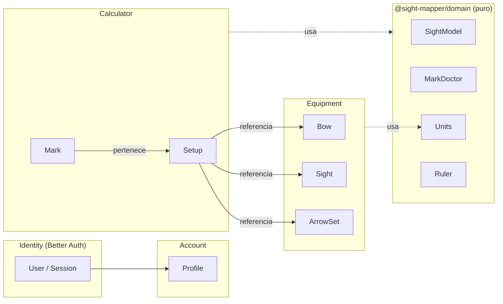
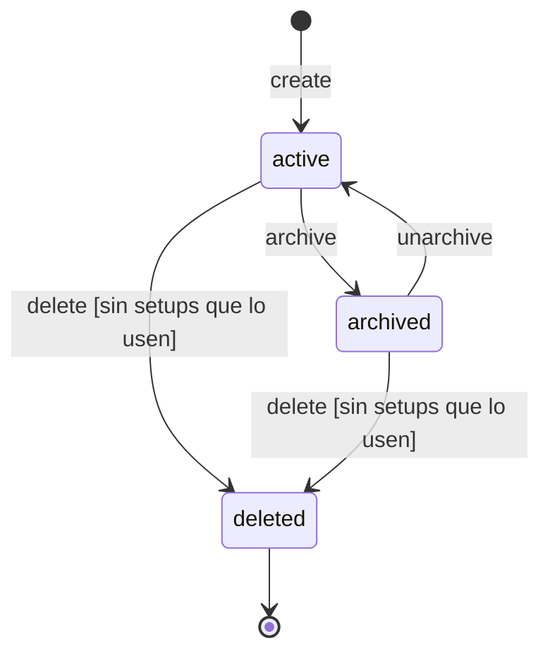
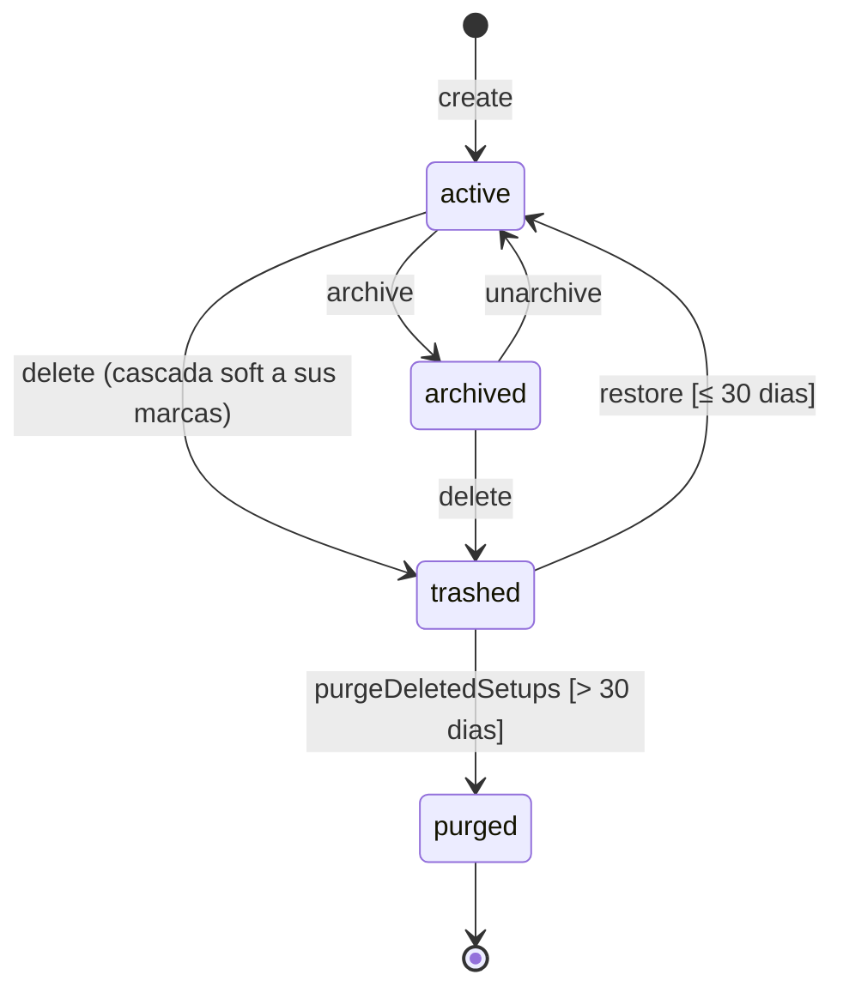
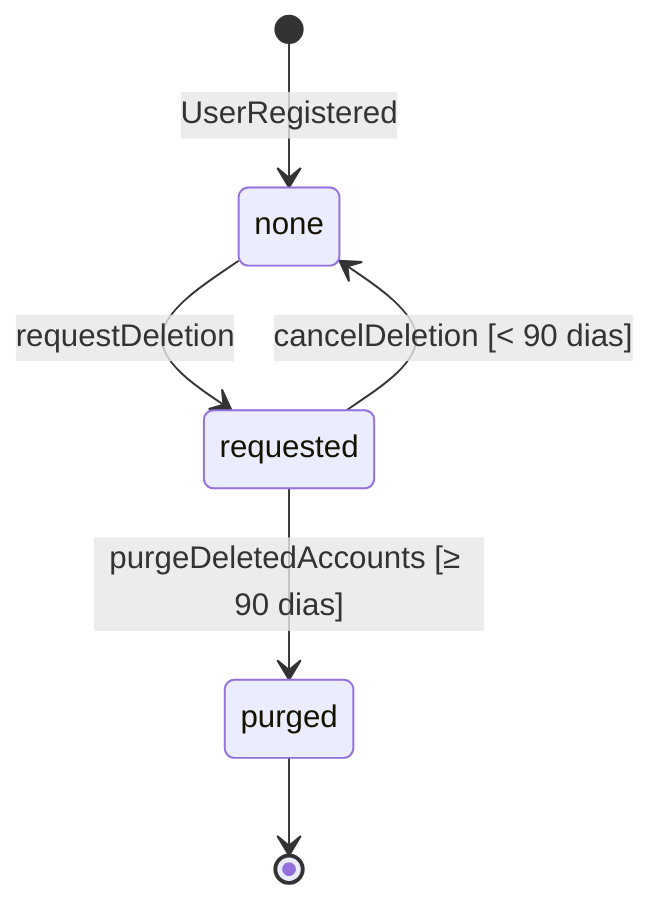
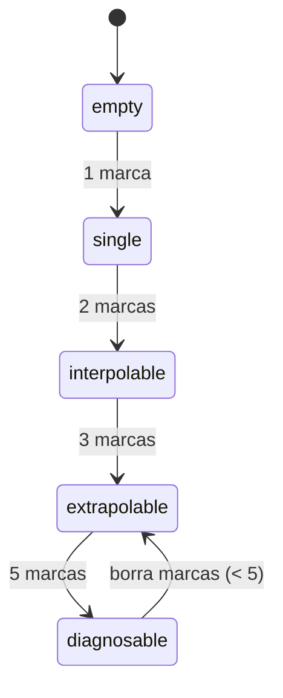

# Dominio — Sight Mapper

> Modelo de dominio: contextos, agregados, invariantes, estados y eventos. El lenguaje ubicuo y el
> diccionario de datos campo por campo estan en [DICCIONARIO.md](DICCIONARIO.md). La matematica,
> en [domain/SIGHT-MATH.md](domain/SIGHT-MATH.md); las unidades, en
> [domain/UNIDADES.md](domain/UNIDADES.md).

---

## 1. Contextos



| Contexto     | Tipo                | Dueño de                                 | Habla con                                       |
| ------------ | ------------------- | ---------------------------------------- | ----------------------------------------------- |
| Identity     | generico (externo)  | usuario, sesion, credenciales, OAuth     | Account (evento `UserRegistered`)               |
| Account      | soporte             | preferencias, baja, export               | todos (lee para exportar, purga al dar de baja) |
| Equipment    | soporte             | arcos, miras, sets de flechas            | Calculator (puerto `ComponentUsagePort`)        |
| Calculator   | **nucleo**          | setups, marcas medidas                   | Equipment (puerto `EquipmentReadPort`)          |
| Domain (math)| **nucleo** (puro)   | modelo de marcas, Doctor, unidades, regla| nadie: es una libreria sin I/O                  |
| Maker (F2)   | nucleo              | diseños de tape, calibracion de impresora| Calculator (lectura de marcas)                  |

Los modulos no se importan entre si: se hablan por **puertos** declarados por quien los necesita e
implementados por quien tiene el dato, cableados en la raiz de composicion. → [ADR-002](adr/002-monorepo-modular-monolith.md)

## 2. Agregados

Regla general: cada agregado es una coleccion, se carga y se guarda entero, lleva `userId`,
`version`, `createdAt`, `updatedAt`, `deletedAt`, y se identifica con un **UUIDv7 generado por el
cliente**.

### 2.1 `Bow` (Equipment)

- Raiz: `Bow`. Sin entidades hijas.
- `bowType`: `compound` (MVP). Discriminador para `recurve` (F3) y `crossbow` (F6+).
- Campos de compuesto: ver [DICCIONARIO.md](DICCIONARIO.md) §3.1.
- Invariantes:
  - `manufacturer` y `model` no vacios (al menos uno de los dos).
  - Cada medida en su rango fisico (ej. `letOffPct ∈ [0, 99]`, `drawLengthMm ∈ [500, 900]`).
- Estados: `active ⇄ archived`.

### 2.2 `Sight` (Equipment)

- Raiz: `Sight`. Value object **`SightScale`**:

  ```ts
  type SightScale = {
    unit: 'mm' | 'cm' | 'in' | 'click' | 'custom';
    unitSizeMm: number | null;   // fijo para mm(1), cm(10), in(25.4); requerido para tape en click/custom
    min: number;                 // en unidades de la escala (lo que el arquero lee)
    max: number;
    resolution: number;          // quantum: el paso que el arquero puede fijar, en unidades de escala
    direction: 'down' | 'up';    // hacia donde crecen los numeros en la mira
  };
  ```

- `pinType`: `monopin` | `dualpin` | `multipin`. En el MVP es descriptivo: el calculo se hace sobre
  el pin de referencia (el superior, el que se calibra con la escala).
- Invariantes:
  - `min < max`; `resolution > 0`; `resolution ≤ max − min`.
  - `unit ∈ {mm, cm, in}` ⇒ `unitSizeMm` es el valor fijo (no editable).
  - `unit ∈ {click, custom}` ⇒ `unitSizeMm` es `null` o `> 0`.
  - Derivados canonicos: `scaleMinMm = min × unitSizeMm`, `scaleMaxMm = max × unitSizeMm` (si
    `unitSizeMm` es `null`, se usa `1` como factor nominal y la mira queda "sin escala fisica").
- Operaciones con reglas especiales:
  - `changeScale(newScale, strategy)` con marcas existentes: ver §4.2.
- Estados: `active ⇄ archived`.

### 2.3 `ArrowSet` (Equipment)

- Raiz: `ArrowSet`. Sin hijos.
- Invariantes: `name` no vacio; medidas en rango fisico; `spine > 0`.
- Estados: `active ⇄ archived`.

### 2.4 `Setup` (Calculator)

- Raiz: `Setup`. Referencia por id a 1 `Bow`, 1 `Sight` y `arrowSetIds: UUID[]` (1..N).
- Invariantes:
  - `arrowSetIds` no vacio y sin repetidos.
  - Unico `(userId, bowId, sightId)` entre los no borrados.
  - Al crear o agregar flechas, cada componente existe, es del usuario y esta `active`
    (verificado via `EquipmentReadPort`).
  - No se quita un `arrowSetId` que tiene marcas no borradas.
- Estados: `active ⇄ archived`; papelera via `deletedAt` (§3).

### 2.5 `Mark` (Calculator)

- **Agregado propio** (no hijo de `Setup`): se crea, edita y borra de a una, con alta frecuencia, y
  conviene que su concurrencia sea independiente del setup.
- Campos: `setupId`, `arrowSetId`, `distanceM`, `scaleValueMm`, `origin`, `note?`, `measuredAt`.
- Invariantes:
  - `0 < distanceM ≤ 300`, redondeada a 0.001 m.
  - `arrowSetId ∈ setup.arrowSetIds`.
  - `scaleValueMm ∈ [sight.scaleMinMm, sight.scaleMaxMm]` (leido en la misma operacion).
  - Unica por `(userId, setupId, arrowSetId, distanceM)` entre las no borradas.
- `origin`: `measured` (MVP) | `seeded` (F6). Lo calculado no se persiste.

### 2.6 `Profile` (Account)

- Uno por usuario (`userId` unico). Creado al recibir `UserRegistered`.
- Campos: `locale`, `unitSystem`, `theme`, `quickAccess?: { setupId, arrowSetId }`,
  `deletionRequestedAt?`.

## 3. Ciclos de vida

### 3.1 Componentes de equipo



`delete` con setups que lo usan → `SM-<BOW|SGT|ARW>-409-001` (params: `setups`, `marks`).

### 3.2 Setup



### 3.3 Cuenta



### 3.4 Calculo de un (setup, set de flechas)



Es un estado **derivado** (no se guarda): sale de contar marcas `measured` no borradas.

## 4. Reglas que cruzan agregados

### 4.1 Borrado protegido de componentes

1. `Equipment` recibe `DELETE /bows/:id`.
2. Pregunta a `ComponentUsagePort.countUsage({ kind: 'bow', id })` → `{ setups, marks }`.
3. Si `setups > 0` → 409 con params. Si no, soft delete.

`ComponentUsagePort` lo declara Equipment y lo implementa Calculator.

### 4.2 Cambio de escala de una mira

Sea `S` la escala vieja y `S'` la nueva, con marcas `m_k` (en mm) de todos los setups que usan la
mira:

- `keepReadings` (default): para cada marca, `lectura = m_k / S.unitSizeMm` y
  `m'_k = lectura × S'.unitSizeMm`. El arquero sigue viendo los numeros que anoto.
- `keepPositions`: `m'_k = m_k`. Cambian las lecturas que se muestran.

Ambas validan que todas las marcas resultantes caigan en `[S'.min, S'.max]` (en mm); si no, 409
`SM-SGT-409-002` con la cantidad. Se aplica en **una transaccion**: mira + todas las marcas.

### 4.3 Validacion de una marca contra su mira

`Calculator` lee la mira via `EquipmentReadPort.getSightScale(sightId)` **dentro de la misma
sesion transaccional** que inserta la marca, para que un cambio de escala concurrente no deje una
marca fuera de rango.

## 5. Eventos de dominio

Bus in-process, sincronico dentro de la transaccion cuando el efecto es parte de la invariante, y
asincronico (despues del commit) cuando no.

| Evento                    | Emite      | Escucha            | Efecto                                             |
| ------------------------- | ---------- | ------------------ | -------------------------------------------------- |
| `UserRegistered`          | Identity   | Account            | Crea `Profile` con defaults del locale del navegador |
| `SetupDeleted`            | Calculator | Account            | Limpia `quickAccess` si apuntaba a ese setup       |
| `SetupRestored`           | Calculator | —                  | (auditoria)                                        |
| `SightScaleChanged`       | Equipment  | Calculator         | Recalcula `scaleValueMm` segun la estrategia (sincronico, misma transaccion) |
| `AccountDeletionRequested`| Account    | —                  | (auditoria; la purga la hace el job)               |
| `AccountPurged`           | Account    | Equipment, Calculator | Borrado fisico de todo lo del usuario          |

## 6. Value objects del paquete puro

| VO                   | Representa                                        | Unidad canonica |
| -------------------- | ------------------------------------------------- | --------------- |
| `Distance`           | Distancia horizontal al blanco                    | metros          |
| `ScalePosition`      | Posicion sobre la escala de la mira               | milimetros      |
| `Reading`            | Lo que el arquero lee en su mira                  | unidad de escala |
| `SightScale`         | Como se traduce `Reading ⇄ ScalePosition`         | —               |
| `MeasuredMark`       | `{ id, distanceM, scaleValueMm }`                 | —               |
| `ComputedMark`       | `{ distanceM, scaleValueMm, kind }` con `kind ∈ measured \| interpolated \| extrapolated` | — |
| `DoctorReport`       | Resultado del analisis                            | —               |

`@sight-mapper/domain` no conoce Mongo, HTTP, React, el reloj ni el azar. → [ADR-001](adr/001-empirical-first.md)
