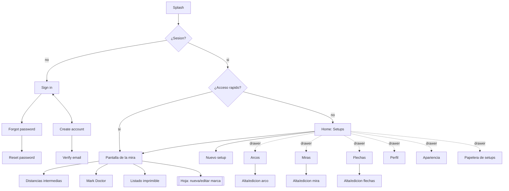
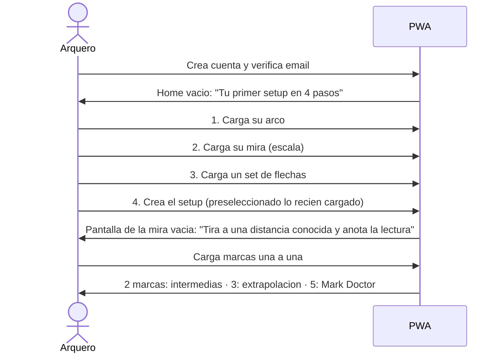

# Documento funcional — Sight Mapper

> Como vive el arquero el producto: flujos, pantallas, historias y criterios de aceptacion.
> Las reglas normativas estan en la [spec](spec/SIGHT-MAPPER-SPEC.md) (`RF-*`, `RN-*`); aca se
> referencian. El sistema visual esta en [UX-UI.md](UX-UI.md).

---

## 1. Mapa de navegacion

### 1.1 Rutas de la PWA

| Ruta                            | Pantalla                          | Diseño                                 | Auth |
| ------------------------------- | --------------------------------- | -------------------------------------- | ---- |
| `/sign-in`                      | Login                             | `Sign in — Bow Sight.png`              | no   |
| `/sign-up`                      | Registro                          | `Create account — Bow Sight.png`       | no   |
| `/forgot-password`              | Pedir recupero                    | sin diseño                             | no   |
| `/reset-password?token=`        | Nueva contraseña                  | sin diseño                             | no   |
| `/verify-email?token=`          | Verificacion                      | sin diseño                             | no   |
| `/`                             | Home: listado de setups           | `Home — Your sets.png`                 | si   |
| `/setups/new`                   | Nuevo setup                       | `New set — Form.png`                   | si   |
| `/setups/:setupId?arrowSet=&d=` | Pantalla de la mira               | `UV slider — *.png`                    | si   |
| `/setups/:setupId/distances`    | Intermedias + curva               | `Calculate distances — Curve.png`      | si   |
| `/setups/:setupId/doctor`       | Mark Doctor                       | sin diseño                             | si   |
| `/setups/:setupId/print`        | Listado imprimible                | sin diseño                             | si   |
| `/setups/:setupId/edit`         | Editar setup (nombre, flechas)    | sin diseño (reusa New set)             | si   |
| `/trash`                        | Papelera de setups                | sin diseño                             | si   |
| `/bows`, `/bows/new`, `/bows/:id` | Arcos                           | `New bow — Full form.png`              | si   |
| `/sights`, `/sights/new`, `/sights/:id` | Miras                     | `New sight — Form.png`                 | si   |
| `/arrows`, `/arrows/new`, `/arrows/:id` | Sets de flechas           | `New arrow set — Form.png`             | si   |
| `/settings/appearance`          | Tema, idioma, unidades            | sin diseño                             | si   |
| `/profile`                      | Cuenta, exportar, baja, version   | sin diseño                             | si   |

Estado en URL (Nuqs): `arrowSet` (set de flechas seleccionado), `d` (distancia seleccionada, en
metros canonicos), `step`, `from`, `to` (intermedias). Compartir o recargar conserva la vista.

## 2. Flujos principales

### 2.1 Primer uso (onboarding)

- El onboarding es una **guia con checklist**, no un wizard bloqueante: cada paso abre el form
  correspondiente y vuelve a la guia al guardar.
- Si el arquero ya tiene equipo cargado, la guia salta los pasos cumplidos.

### 2.2 En el campo (uso diario)

1. Abre la app → si tiene **acceso rapido**, cae directo en la pantalla de la mira de ese setup y
   set de flechas.
2. Toca una distancia de la tabla o de la regla → la lectura grande muestra `distancia → lectura`.
3. Tira, ajusta la mira, y si cambio algo toca **+ Add sight mark** (siempre al alcance del
   pulgar) → hoja con distancia y lectura → Guardar (optimista, con deshacer).
4. Si el Doctor señala una marca, vuelve a tirar esa distancia y la reemplaza.

### 2.3 En casa

1. Revisa la curva y las intermedias con paso fino.
2. Imprime el listado de distancias (F1) o diseña el tape (MAKER, F2).

## 3. Historias de usuario y criterios de aceptacion

Formato: `HU-<MOD>-<NN>` · referencia a `RF-*` · criterios Given/When/Then.

### 3.1 Cuenta

**HU-ACC-01 — Registrarme** (RF-ACC-01)

- Given no tengo cuenta, When envio email, username y dos contraseñas iguales de ≥ 8 caracteres,
  Then se crea la cuenta, se envia el email de verificacion y veo "Revisa tu correo".
- Given el email ya existe, When envio el registro, Then veo el error `SM-AUTH-409-001` en el campo
  email.
- Given el username ya existe, Then veo `SM-AUTH-409-002` en el campo username.
- Given las contraseñas no coinciden, Then el form no se envia y muestra el error en el segundo
  campo (validacion de cliente).

**HU-ACC-02 — Entrar** (RF-ACC-02)

- Given tengo cuenta verificada, When ingreso email **o** username y contraseña correctos, Then
  entro al Home (o al acceso rapido).
- Given credenciales invalidas, Then veo `SM-AUTH-401-001` sin indicar cual de los dos fallo.
- Given no verifique el email, Then veo `SM-AUTH-403-001` con boton "Reenviar verificacion".
- Given toco "Login with Google" y autorizo, Then entro; si es la primera vez, se crea la cuenta con
  username sugerido editable en Perfil.
- Given supere 5 intentos fallidos en 15 min, Then veo `SM-CORE-429-001` con el tiempo de espera.

**HU-ACC-03 — Recuperar contraseña** (RF-ACC-03)

- Given pido recupero con un email, Then siempre veo "Si el email existe, te enviamos un enlace"
  (no se revela si existe).
- Given abro el enlace dentro de 1 h y defino una contraseña valida, Then queda cambiada y se
  cierran las otras sesiones.
- Given el enlace vencio o ya se uso, Then veo `SM-AUTH-400-002` con boton "Pedir otro".

**HU-ACC-04 — Preferencias** (RF-ACC-04)

- Given estoy en metrico, When cambio a imperial, Then todas las distancias se muestran en yardas
  sin que cambie ningun dato guardado, y la regla y la tabla se recalculan al instante.
- Given cambio el idioma a EN, Then toda la UI, los errores y los formatos numericos (punto
  decimal) cambian sin recargar.
- Given elijo tema `system`, Then la app sigue la preferencia del sistema operativo.

**HU-ACC-05 — Descargar mis datos** (RF-ACC-05)

- When toco "Descargar mis datos", Then se descarga un JSON con perfil, arcos, miras, flechas,
  setups y marcas (incluidos archivados y en papelera), con unidades canonicas y `schemaVersion`.

**HU-ACC-06 — Pedir la baja** (RF-ACC-06)

- When pido la baja y confirmo escribiendo mi username, Then veo la fecha de purga (+90 dias), la
  explicacion de por que no es inmediata, y un boton "Cancelar la baja".
- Given pasaron 90 dias, Then el job `purgeDeletedAccounts` elimina todos mis datos y mi identidad.

### 3.2 Equipo

**HU-BOW-01 — Cargar un arco** (RF-EQP-01)

- Given estoy en "New bow", When completo al menos fabricante y modelo y guardo, Then el arco
  aparece en "Your bows" con la fecha de edicion.
- Given escribo brace height `6 1/4` en imperial, Then se acepta como 6.25 in (fracciones admitidas).
- Given un valor fuera de rango (ej. let-off 120%), Then veo `SM-CORE-400-001` en ese campo.

**HU-SGT-01 — Cargar una mira con su escala** (RF-EQP-02)

- Given elijo unidad `custom` con minimo 1, maximo 9 y un largo fisico de 80 mm entre el 1 y el 9,
  Then `unitSizeMm = 10` y la regla dibuja 1–9 a escala real.
- Given elijo `click` y no se el tamaño del click, Then puedo guardar; la regla se dibuja
  proporcional y aparece el aviso "Sin tamaño de click: el tape a escala no estara disponible".
- Given elijo direccion "crece hacia arriba", Then la regla muestra el minimo abajo.
- Given `scaleMin ≥ scaleMax`, Then veo `SM-CORE-400-001` en el campo maximo.

**HU-SGT-02 — Cambiar la escala de una mira con marcas** (RF-EQP-06)

- Given la mira tiene 6 marcas y cambio `unitSizeMm`, When guardo, Then se me pregunta: "¿Conservar
  las lecturas que anotaste (recomendado) o la posicion fisica?". Al elegir, se aplica en una
  transaccion.
- Given reduzco el maximo de 9 a 5 y hay 2 marcas en 6 y 7, Then veo `SM-SGT-409-002` con
  `count = 2` y no se guarda nada.

**HU-ARW-01 — Cargar un set de flechas** (RF-EQP-03)

- Given completo nombre corto y guardo, Then el set aparece en "Your arrows". Los demas campos son
  opcionales ("deja vacio lo que no mediste").

**HU-EQP-01 — Archivar y borrar** (RF-EQP-04, RF-EQP-05)

- Given un arco usado por 2 setups con 14 marcas, When intento borrarlo, Then veo
  `SM-BOW-409-001` con `setups = 2, marks = 14` y el boton "Archivar".
- Given archivo el arco, Then deja de aparecer en el selector de "Nuevo setup" y los 2 setups
  siguen funcionando con el badge "arco archivado".
- Given un arco sin setups, When lo borro, Then desaparece (soft delete) y veo "Deshacer" 8 s.

### 3.3 Setups

**HU-STP-01 — Crear un setup** (RF-STP-01)

- Given tengo al menos un arco, una mira y un set de flechas activos, When elijo los tres y guardo,
  Then el setup aparece en el Home y se abre su pantalla de la mira.
- Given ya existe un setup con ese arco y esa mira, Then veo `SM-STP-409-001` con el enlace
  "Agregar estas flechas al setup existente".
- Given me falta alguno de los tres componentes, Then cada select vacio ofrece "+ Cargar uno nuevo"
  y vuelve al form con lo cargado preseleccionado.

**HU-STP-02 — Home** (RF-STP-02, RF-STP-03)

- Given tengo 4 setups y 1 favorito, Then el favorito aparece primero, despues el resto por ultima
  edicion descendente. Cada card muestra arco, mira · tipo de pin, flechas y ultima edicion.
- When toco la estrella de un setup, Then pasa a favoritos al instante (optimista).

**HU-STP-03 — Acceso rapido** (RF-STP-04)

- Given marco "Abrir siempre aca" en la pantalla de la mira de un setup con un set de flechas, When
  vuelvo a abrir la app, Then caigo directo en esa pantalla con ese set seleccionado.
- Given borro ese setup, Then el acceso rapido se limpia y la app abre en el Home.

**HU-STP-04 — Papelera** (RF-STP-06)

- Given borro un setup con 12 marcas, Then desaparece del Home y aparece en la Papelera con "se
  elimina el <fecha +30 d>". When lo restauro, Then vuelven el setup y sus 12 marcas.
- Given pasaron 30 dias, When intento restaurar, Then veo `SM-STP-410-001`.

### 3.4 Marcas y pantalla de la mira

**HU-MRK-01 — Cargar una marca** (RF-MRK-01)

- Given estoy en la pantalla de la mira con un set de flechas elegido, When toco "+ Add sight
  mark", ingreso `40` m y lectura `3.5` y guardo, Then la marca aparece de inmediato en la regla y
  en la tabla como "Registered" y veo "Deshacer".
- Given no hay set de flechas elegido, Then el boton abre primero el selector de flechas.
- Given la lectura `9.5` esta fuera de la escala `1–9`, Then veo `SM-MARK-422-001` con `min = 1,
  max = 9`.
- Given la distancia `0` o `350`, Then veo `SM-CORE-400-001` en distancia.

**HU-MRK-02 — Distancia repetida** (RF-MRK-02)

- Given ya existe una marca a 40 m, When cargo otra a 40 m, Then veo "Ya tenes 40 m → 3.5.
  ¿Reemplazar por 3.6?". Al confirmar se reenvia con `replace: true` y queda una sola.

**HU-MRK-03 — Editar y borrar** (RF-MRK-03)

- Given toco una marca, Then puedo editar distancia, lectura, nota y fecha, o borrarla con
  "Deshacer" 8 s.
- Given otro dispositivo la edito antes, When guardo, Then veo `SM-CORE-412-001` y la version
  actual para decidir.

**HU-MRK-04 — Pantalla de la mira** (RF-MRK-04, RF-CAL-07)

- Then veo: nombre de la mira y del arco, resumen (`5 marks · 20–60 m`), herramientas (Wind y
  Weather deshabilitados con "Proximamente", Doctor, Print), selector de set de flechas, lectura
  grande de la distancia seleccionada, regla + tabla, "Calculate intermediate distances" y "+ Add
  sight mark".
- Given 0 marcas, Then veo el estado vacio de `UV slider — Empty state.png` con la checklist "Set de
  flechas / Marca medida" y "Calculation needs at least 2 sight marks. You have 0".
- Given toco una fila de la tabla o un punto de la regla, Then esa distancia queda seleccionada
  (URL `?d=`) y la lectura grande se actualiza.
- Given dos marcas muy cercanas en la regla, Then las etiquetas no se superponen: se desplazan con
  una linea guia y el punto queda en su posicion exacta.

### 3.5 Calculo

**HU-CAL-01 — Calculo escalonado** (RF-CAL-01)

- Given 1 marca, Then "Calculate intermediate distances" esta deshabilitado con "Necesitas 2 marcas.
  Tenes 1".
- Given 2 marcas (20 y 40 m), Then puedo ver intermedias **entre 20 y 40**; pedir 50 m responde
  "Necesitas 3 marcas para estimar fuera de lo que tiraste" (`SM-CALC-422-002`).
- Given 3 marcas, Then puedo ver distancias fuera del rango, marcadas `≈` y con aviso si se alejan
  mas de 25% del rango medido.
- Given 5 marcas, Then el boton Doctor se habilita.

**HU-CAL-02 — Intermedias** (RF-CAL-02, RF-CAL-04)

- Given marcas a 20, 30, 40, 50 y 60 m y paso 5, Then veo 20, 25, … 60 con 25/35/45/55 como
  calculadas (rombo, `≈`) y las medidas exactamente iguales a lo cargado.
- Given estoy en imperial con paso 5 yd, Then la grilla es 20, 25, 30… yd (no metros convertidos).
- Then la curva muestra lo medido en linea solida y lo calculado punteado.

**HU-CAL-03 — Consultar una distancia libre** (RF-CAL-03)

- Given marcas 20–60 m, When consulto 45 m, Then veo la lectura estimada como rombo en la regla y en
  la curva, y **ninguna marca registrada cambia**.

**HU-CAL-04 — Mark Doctor** (RF-CAL-05, RF-CAL-06)

- Given 5+ marcas consistentes, Then el Doctor dice "Tus marcas son consistentes" y muestra el
  residuo de cada una.
- Given una marca a 40 m anotada 0.8 unidades fuera de la tendencia, Then el Doctor la señala con
  su magnitud en la escala de la mira y "Volve a tirar 40 m". No la cambia ni la borra.
- Given 50 m tiene la mira mas arriba que 40 m (no monotono), Then ambas marcas muestran el aviso de
  inconsistencia desde las 2 marcas, sin esperar a 5.

**HU-CAL-05 — Listado imprimible** (RF-CAL-08)

- When toco Print, Then veo una vista de impresion con encabezado (setup, flechas, fecha, unidad),
  la tabla de distancias con el paso elegido, lo estimado con `≈` y nota al pie, y puedo imprimir
  o guardar como PDF desde el navegador.

## 4. Mensajes y textos clave

Todos viven en los catalogos (`@sight-mapper/i18n`). Ejemplos de claves:

| Clave                                  | ES                                                         | EN                                                     |
| -------------------------------------- | ---------------------------------------------------------- | ------------------------------------------------------ |
| `calc.progress`                        | Necesitas {{need}} marcas. Tenes {{have}}.                 | Calculation needs at least {{need}} sight marks. You have {{have}}. |
| `calc.estimated`                       | Estimado                                                   | Calculated                                             |
| `mark.registered`                      | Registrada                                                 | Registered                                             |
| `doctor.suspect`                       | Volve a tirar {{distance}}: se aparta {{delta}} de la tendencia. | Re-shoot {{distance}}: it is {{delta}} off the trend. |
| `common.comingSoon`                    | Proximamente                                               | Coming soon                                            |
| `errors.mark.outOfScale`               | La lectura tiene que estar entre {{min}} y {{max}}.        | The reading must be between {{min}} and {{max}}.       |

## 5. Casos limite que el producto tiene que resolver

| Caso                                                   | Comportamiento                                                   |
| ------------------------------------------------------ | ---------------------------------------------------------------- |
| El arquero tira la misma distancia dos veces           | Conflicto explicito, elige reemplazar (RN-MRK-04)                |
| Marcas en yardas y metros mezcladas                    | Todo es canonico en metros; se muestra en la unidad elegida      |
| 20 yd = 18.288 m y 18 m (sala) en el mismo set         | Son distancias distintas; ambas validas                          |
| La lectura calculada cae fuera de la escala            | "Fuera de escala", nunca recortada (RN-CAL-04)                   |
| Cambia de mira pero conserva el arco                   | Es otro setup (otra calibracion)                                 |
| Mueve la mira a otro arco                              | Nuevo setup arco B + mira; las marcas del setup A quedan intactas |
| Sin conexion (MVP)                                     | Lectura de lo ya cargado en cache; escritura muestra `SM-NET-503-001` con reintento. Offline completo: F4 |
| Dos dispositivos editan la misma marca                 | El segundo recibe 412 y decide (RN de concurrencia, ADR-006)     |
