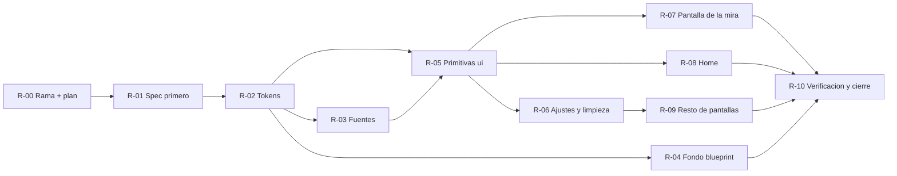

# Plan de accion — Rediseño retro-futurista blueprint

> Formato igual a `docs/ACTION-PLAN.md`: `[ ]` sin iniciar · `[~]` en proceso · `[x]` hecha ·
> `[!]` bloqueada. Puntos Fibonacci (1 ≈ medio dia). Cada tarea cumple DoR/DoD de spec §20.
> En R-00 estas tareas se copian a `docs/ACTION-PLAN.md` como **F1-23..F1-33** (antes de F1-22,
> el release: conviene salir con el diseño nuevo). Nunca renumerar ids existentes.
>
> **Total: 11 tareas · 34 puntos.** Solo presentacion: no se toca `@sight-mapper/domain`, la API
> ni los datos. Ningun codigo de error nuevo (no hace falta tocar `docs/errors.md`).

## Revision contra el repo (2026-11-16, Claude Code)

El plan se contrasto con el codigo real antes de arrancar. Ajustes ya aplicados abajo:

- R-00: la rama ya existe sobre `296f2db`; quedan los pasos 2b–5.
- R-02/R-03: el `Caddyfile` vive en `apps/pwa/Caddyfile`. R-02 tambien actualiza los 9 asserts
  `'44px'` de los tests de `ui`.
- R-06: suma el riel lateral de 1440 que pide `LAYOUT.md` y ningun task cubria.
- R-07: `QuickAccessToggle` esta en `features/account/`, no en `features/sight/`.

Arranque concreto (en orden, un commit por paso):

1. **R-00** — copiar el comando `/redesign`, commitear `docs/redesign/`, cerrar D-1..D-8 con el
   autor, pasar R-01..R-10 a `docs/ACTION-PLAN.md` como F1-23..F1-33.
2. **R-01** — aplicar `SPEC-CHANGES.md` (el hook pide confirmacion en `docs/spec/`), ADR-012,
   `spec-reviewer`. Ningun codigo antes de esto.
3. **R-02** — tokens + `tokens.test.ts` en verde; es la base de todo lo visual.
4. Despues, en paralelo posible: **R-03** (fuentes) y **R-04** (fondo); luego **R-05** y el
   abanico R-06/R-07/R-08 (archivos disjuntos), R-09, R-10.

## Orden y dependencias

| Id | Id en ACTION-PLAN | Titulo | Pts | Depende de |
| --- | --- | --- | --- | --- |
| R-00 | F1-23 | Rama, plan integrado y decisiones D-1..D-8 | 1 | — |
| R-01 | F1-24 | Spec, UX-UI, FUNCIONAL, TECNICO y ADR-012 | 2 | R-00 |
| R-02 | F1-25 | Tokens de color, forma y tamaño | 3 | R-01 |
| R-03 | F1-26 | Fuentes propias precacheadas | 3 | R-02 |
| R-04 | F1-27 | Fondo blueprint | 2 | R-02 |
| R-05 | F1-28 | Primitivas de `@sight-mapper/ui` restilizadas | 5 | R-02, R-03 |
| R-06 | F1-29 | Ajustes como unico lugar de configuracion | 3 | R-05 |
| R-07 | F1-30 | Pantalla de la mira reacomodada | 5 | R-05 |
| R-08 | F1-31 | Home y SetupCard | 2 | R-05 |
| R-09 | F1-32 | Resto de pantallas | 3 | R-06 |
| R-10 | F1-33 | Verificacion, capturas y cierre | 5 | R-04, R-07, R-08, R-09 |

---

### [x] R-00 · Rama, plan integrado y decisiones

- **Modulo:** repo, docs · **Puntos:** 1 · **Depende de:** —
- **Descripcion:**
  1. ✅ Hecho: `feat/redesign-blueprint` ya existe y sale de `296f2db` (punta de
     `feat/f0-railway-config`, 1 commit adelante de `main` = `origin/main` = `cd18b18`). El PR del
     rediseño arrastra ese commit de infra salvo que `feat/f0-railway-config` se mergee antes.
  2. ✅ Hecho (`docs/redesign/` sin trackear en la rama nueva).
  2b. Copiar `docs/redesign/redesign-command.md` a `.claude/commands/redesign.md` (comando
     `/redesign`; desde Cowork no se puede escribir en `.claude/`).
  3. Commit: `docs(docs): add the blueprint redesign handoff and plan` (`redesign` no esta en el scope-enum de commitlint) (en ingles, commitlint).
  4. Resolver con el autor **D-1..D-8** (`DECISIONES.md` §6) y anotar las respuestas ahi mismo.
  5. Copiar R-01..R-10 a `docs/ACTION-PLAN.md` como F1-23..F1-33 (formato del plan, tabla de fases
     F1 pasa de 22 tareas / 85 puntos a 33 / 119; F1-22 depende ahora de F1-33), con `/new-task` como guia.
- **Criterios:**
  - Given `git branch --show-current`, Then dice `feat/redesign-blueprint` y `git log -1` es el
    commit de docs.
  - Given `docs/ACTION-PLAN.md`, Then F1-23..F1-33 existen y la tabla de estado los cuenta.
  - Given `DECISIONES.md` §6, Then cada D-x tiene la respuesta del autor.

### [x] R-01 · Spec primero: spec, UX-UI, FUNCIONAL, TECNICO y ADR-012

- **Modulo:** docs · **Puntos:** 2 · **Depende de:** R-00
- **Descripcion:** aplicar `SPEC-CHANGES.md` completo (marcas `[+]`/`[~]`, nada se borra). Crear
  `docs/adr/012-own-fonts-precached.md` con `/adr` desde el borrador y sumarlo a
  `docs/adr/README.md`. Fila nueva en `docs/README.md`. `CLAUDE.md`: Estado, Stack y ADRs.
- **Criterios:**
  - Given la spec, Then RF-ACC-04 dice "solo en Ajustes" con la excepcion del idioma en invitado y
    §14 tiene los 4 puntos nuevos.
  - Given `UX-UI.md`, Then §2 tiene los valores finales de ambos temas (no "aproximados") y §4.5/§4.6
    existen.
  - Given `FUNCIONAL.md` §1.1, Then la ruta es `/settings` y `/settings/appearance` redirige.
  - Given `docs/adr/README.md`, Then lista ADR-012.
- **Verificar:** `spec-reviewer` (agente del repo) sobre el diff de docs.

### [x] R-02 · Tokens de color, forma y tamaño

- **Modulo:** ui · **Puntos:** 3 · **Depende de:** R-01
- **Archivos:** `packages/ui/src/styles/tokens.css`, `packages/ui/src/styles/theme.css`,
  `packages/ui/src/tokens.test.ts`, `packages/ui/src/touch.ts`, `apps/pwa/src/styles.css`,
  `apps/pwa/index.html`, `apps/pwa/vite.config.ts` (manifest).
- **Descripcion:**
  - Valores de `DESIGN-SYSTEM.md` §2.1 en los **tres** bloques de `tokens.css`, conservando los
    nombres actuales y sumando los nuevos (mapeo en `DESIGN-SYSTEM.md` §3): `--sm-surface-raised`,
    `--sm-line`, `--sm-grid`, `--sm-grid-major`, `--sm-focus`, `--sm-shadow-key`,
    `--sm-shadow-panel`, `--sm-size-touch: 48px`, `--sm-size-touch-lg: 56px`, `--sm-grid-step: 8px`,
    `--sm-grid-step-major: 40px`.
  - `theme.css`: `--color-raised`, `--color-line`, `--color-grid`, `--color-grid-major`,
    `--color-focus`, `--shadow-key`, `--shadow-panel`, `--radius-lg: 8px`, `--font-mono`.
  - `touch.ts`: `TOUCH_TARGET_PX` 44 → 48. Hay 9 asserts con `'44px'` literal en
    `components/{forms,feedback,overlays}.test.tsx`: pasarlos a `${TOUCH_TARGET_PX}px` en el mismo
    commit (no es esquivar un test: el requisito cambio por spec).
  - `styles.css`: foco `outline: 3px solid var(--sm-focus)`.
  - `index.html` `theme-color` y manifest `theme_color`/`background_color` → `#0b1b45` (D-5). El
    script inline del tema **no** se toca (su hash esta en la CSP de `apps/pwa/Caddyfile` y lo vigila
    `scripts/csp.test.mjs`).
  - Actualizar el comentario de cabecera de `tokens.css` (el acento claro ahora es navy).
- **Criterios:**
  - Given `tokens.test.ts`, Then verifica en dark, light y system: `text` ≥7 y `text-muted` ≥4,5
    sobre `bg`, `surface`, `surface-raised`, `surface-sunken`; `mark`, `info`, `warning`, `danger`
    ≥4,5 sobre las mismas; `accent-ink` sobre `accent` ≥7; `border` y `focus` ≥3. Valores esperados
    en `DESIGN-SYSTEM.md` §2.3.
  - Given el bloque light y el bloque `prefers-color-scheme: light`, Then son identicos (el test
    actual ya lo exige).
  - Given `pnpm --filter @sight-mapper/ui test` y `pnpm typecheck`, Then pasan.

### [x] R-03 · Fuentes propias precacheadas

- **Modulo:** ui, pwa · **Puntos:** 3 · **Depende de:** R-02
- **Archivos:** `packages/ui/src/fonts/` (nuevo), `packages/ui/src/styles/fonts.css` (nuevo),
  `packages/ui/package.json` (export `./fonts.css`), `apps/pwa/src/styles.css`,
  `apps/pwa/vite.config.ts`.
- **Descripcion:**
  - Copiar los 8 woff2 de `docs/redesign/design-system/fonts/` a `packages/ui/src/fonts/` con sus
    licencias (`licenses/*-OFL.txt`).
  - `fonts.css` con un `@font-face` por archivo (`font-display: swap`, `url('../fonts/…')` relativo
    para que Vite los empaquete con hash en `/assets/`). Importarlo en `apps/pwa/src/styles.css`
    antes de `tokens.css`.
  - `theme.css`: `--font-display: 'Chakra Petch', …`, `--font-ui: 'IBM Plex Sans', …`,
    `--font-mono: 'IBM Plex Mono', …` (stacks en `DESIGN-SYSTEM.md` §2.2). Borrar el comentario
    "No web fonts" (ADR-012).
  - `vite.config.ts` → `workbox.globPatterns`: sumar `woff2`.
  - Opcional si el LCP empeora: fallbacks con `size-adjust`/`ascent-override` para reducir CLS, o
    precargar solo Plex Sans 400 + Chakra Petch 700.
- **Criterios:**
  - Given la PWA construida, When abro offline (service worker activo), Then los textos usan Chakra
    Petch / IBM Plex (DevTools → Computed → Rendered fonts).
  - Given Lighthouse CI (`pnpm --filter @sight-mapper/pwa test:lighthouse`), Then el gate de JS
    ≤180 KB sigue pasando y el LCP queda ≤ ~2,6 s (aviso, no gate; anotar el numero en la bitacora).
  - Given la CSP de `apps/pwa/Caddyfile`, Then no cambia (`font-src 'self'` ya alcanza).
  - Given `e2e/installable.spec.ts`, Then verifica que el precache del service worker incluye los
    woff2 (lo exige ADR-012).

### [~] R-04 · Fondo blueprint

- **Modulo:** ui, pwa · **Puntos:** 2 · **Depende de:** R-02
- **Descripcion:** fondo de cuadricula para el `body` (clase o regla base en `styles.css`, valores
  de `design-system/components/bundle.css` `.sm-blueprint`), fijo al scroll; variante con marcas de
  registro para el layout de invitado. Se quita en `@media print` (ya se fuerza fondo blanco).
  Revisar que ningun dato quede directo sobre `bg`: solo titulos y saludos.
- **Criterios:**
  - Given cualquier pantalla en dark y light, Then se ve la cuadricula de 8/40 px y ningun texto de
    datos (lectura, tabla, formulario) esta sobre ella sin superficie opaca.
  - Given imprimir el listado, Then no hay cuadricula.
  - Given el E2E de contraste, Then sigue en 0 problemas (la cuadricula es `background-image` y no
    altera el color de fondo que mide `contrast.ts`).

### [x] R-05 · Primitivas de `@sight-mapper/ui` restilizadas

- **Modulo:** ui · **Puntos:** 5 · **Depende de:** R-02, R-03
- **Archivos:** `packages/ui/src/components/{button,fields,feedback,layout,overlays,segmented}.tsx`
  y sus tests; `apps/pwa/src/features/sandbox/catalog.tsx`.
- **Descripcion:** traducir a Tailwind cada componente segun `design-system/components/<X>/`
  (README = reglas, `preview.html` = markup, `bundle.css` = medidas exactas):
  - `Button`: borde 2 px, `shadow-key`, presion `translate-y-0.5`; variantes nuevas `ghost` y
    `danger`; props `size="lg"` (56 px) y `block`.
  - `Field`/`NumberField`/`PasswordField`/`Select`: borde 2 px, `NumberField` en `font-mono
    tabular-nums`, error con icono de cruz.
  - `Segmented`: cuadrado indicador antes de la etiqueta elegida.
  - `StatusBadge`: mono MAYUSCULAS 12 px, `calculated` con borde punteado.
  - `InfoAlert`: borde 2 px, titulo opcional; `Toast`/`UpdatePrompt`: `shadow-panel` + barra de
    tiempo `accent` 3 px (decorativa, `aria-hidden`); `EmptyState`/`ErrorState`/`Skeleton`: glifo de
    escala, barrido tipo escaner (anulado por `prefers-reduced-motion`).
  - `SectionCard`: prop nueva `index?: string` ("01") en `text-mark` mono; regla punteada `line`.
  - `AppHeader`: `bg-raised`, borde 2 px, logo = `` del icono real (`/pwa-192.png`), solo slot
    de accion para el menu.
  - `NavDrawer`/`NavItem`: grupos con rotulo (`NavGroup` nuevo o prop `group`), icono, barra
    izquierda `accent` 4 px en `aria-current="page"`, `shadow-panel`.
  - `BottomSheet`: `rounded-t-lg`, `shadow-panel`, asa.
  - Iconos: SVG inline 20 px trazo 2 `stroke-linecap="square"` (paths en los previews).
  - Catalogo `/sandbox`: mostrar las variantes nuevas.
- **Criterios:**
  - Given los tests de `ui` (forms, feedback, overlays), Then pasan sin bajar cobertura.
  - Given `/sandbox` en dark y light, Then cada componente coincide con `screenshots/<tema>/<X>.png`
    (revision a ojo, anotar diferencias).
  - Given teclado, Then foco visible `focus` 3 px en todos.

### [x] R-06 · Ajustes como unico lugar de configuracion

- **Modulo:** pwa, i18n · **Puntos:** 3 · **Depende de:** R-05
- **Archivos:** `apps/pwa/src/routes/_app.settings.index.tsx` (nuevo, o renombrar
  `_app.settings.appearance.tsx`), `apps/pwa/src/features/account/appearance-screen.tsx` →
  `settings-screen.tsx`, `apps/pwa/src/app/shell.tsx`, `apps/pwa/src/features/menu/app-frame.tsx`,
  `apps/pwa/src/routes/_guest.tsx`, `reset-password.tsx`, `verify-email.tsx`,
  `apps/pwa/src/features/account/profile-screen.tsx`, `packages/i18n/src/locales/{es,en}.ts`,
  `apps/pwa/e2e/{imperial.spec.ts,tour.ts}`.
- **Descripcion:**
  - Pantalla Ajustes con `SectionCard` 01 Pantalla (tema) · 02 Idioma y unidades · 03 Acerca de
    (version, que sale del pie y, si estaba, de Perfil). Cada ajuste con nombre, descripcion y
    `Segmented`. Se reutiliza `usePreferenceActions` (sin cambios de logica).
  - `/settings/appearance` → `redirect` a `/settings`.
  - `Shell`: quitar `AppFooter` y `PreferencesBar` (y sus tests: `update-banner.test.tsx` u otros que
    los monten).
  - Menu: grupos "01 — Tiro" y "02 — Cuenta"; "Apariencia" pasa a "Ajustes".
  - 1440 (`LAYOUT.md` §Breakpoints): el menu pasa a riel lateral fijo de 320 px y el contenido a
    `max-w-[1200px]` centrado. Hoy `app-frame.tsx` no tiene ningun breakpoint `lg:`/`xl:`: es
    trabajo nuevo, no solo estilo. Criterio: Given 1440, Then el menu se ve sin abrir el drawer.
  - `LanguageSwitch` (ES/EN, `aria-pressed`, `lang`) arriba a la derecha en `_guest`,
    `reset-password` y `verify-email`. Sin selector de tema en invitado (sigue al sistema).
  - Claves i18n nuevas en ES y EN (sin strings en JSX): `menu.settings`, `menu.groupShooting`,
    `menu.groupAccount`, `settings.title`, `settings.display`, `settings.languageUnits`,
    `settings.about`, `settings.themeHint`, `settings.unitsHint`, `languageSwitch.label`. Dejar de
    usar `menu.appearance`/`screens.appearance` (borrarlas si `catalog.test.ts` lo permite).
  - E2E: `imperial.spec.ts` y `tour.ts` a `/settings` (nombre del heading nuevo).
- **Criterios:**
  - Given cualquier pantalla con sesion, Then no hay controles de tema ni idioma fuera de Ajustes.
  - Given `/settings/appearance`, Then termino en `/settings`.
  - Given `/sign-in` sin sesion, When toco EN, Then la pantalla cambia a ingles sin recargar y
    persiste (`sm.locale`).
  - Given `catalog.test.ts`, Then ES y EN tienen las mismas claves.

### [x] R-07 · Pantalla de la mira reacomodada

- **Modulo:** pwa (+ ui si D-3 dice que suben) · **Puntos:** 5 · **Depende de:** R-05
- **Archivos:** `apps/pwa/src/features/sight/sight-screen.tsx`, `ruler.tsx`, `mark-sheet.tsx`,
  `../account/quick-access-toggle.tsx`; tests `ruler.test.tsx`, `e2e/sight.spec.ts`, `critical-flow.spec.ts`.
- **Descripcion:**
  - Orden: cabecera (Volver, mira, "setup · N marcas") → `Select` set de flechas → **ReadingHud**
    (distancia + lectura, `readout-xl` 72 px mono, medido `mark` / estimado `info` + `≈`, esquinas
    HUD, brillo de fosforo solo dark segun D-6) → **regla + tabla** (filas 60 px, elegida con barra
    `accent`, sospechosa con triangulo) + **leyenda** → **ActionBar** fija abajo
    (`safe-area-inset-bottom`): herramientas segun **D-1**, "Agregar marca" `lg block`, tira de estado.
  - Se mantienen todas las reglas: Viento/Clima "Proximamente", Doctor desde 5 marcas (badge
    `X/5`), Imprimir desde 1, "Abrir siempre aca", estado vacio con checklist 2/3/5,
    `scale.direction`, toast con Deshacer 8 s, URL `?arrowSet=&d=`.
  - La geometria de la regla sigue saliendo de `@sight-mapper/domain/ruler`: solo cambian clases y
    colores (medido: linea solida + punto `mark`; calculado: punteado + rombo `info`; elegido:
    linea `accent` (claro: `text`) + anillo).
  - 768+: HUD a la izquierda, regla+tabla a la derecha; herramientas sobre la regla; la primaria
    visible sin scroll.
  - Que el contenido no quede tapado por la `ActionBar` fija (padding inferior del `main`).
- **Criterios:**
  - Given una mira con 5 marcas a 360 px, Then sin scroll se ven HUD y "Agregar marca".
  - Given `sight.spec.ts`, `critical-flow.spec.ts`, `keyboard.spec.ts`, Then pasan (ajustar
    selectores solo si cambio el rol o el nombre accesible, nunca para esquivar un bug).
  - Given tocar una fila, Then cambia la distancia elegida y `d` en la URL (como hoy).

### [x] R-08 · Home y SetupCard

- **Modulo:** pwa · **Puntos:** 2 · **Depende de:** R-05
- **Archivos:** `apps/pwa/src/features/setups/home-screen.tsx`, `first-setup-guide.tsx`,
  `e2e/setups.spec.ts`, `e2e/quick-access.spec.ts`, `e2e/onboarding.spec.ts`.
- **Descripcion:** saludo `label` + "Tus setups" `display-lg` sobre la cuadricula; tarjetas iguales
  (`display-md` arco, bloque `sunken` con Mira en `mark` y Flechas, pie con fecha mono); **estrella
  de favorito se mantiene**; chapa "Acceso rapido" con pin en la tarjeta que abre la app; "Crear
  setup" fijo abajo `lg block`; se quita el pie "Sets guardados" (D-4). La guia de primer uso con el
  estilo nuevo (`SectionCard` numeradas).
- **Criterios:**
  - Given 2 setups (uno favorito y de acceso rapido), Then el favorito va primero, tiene estrella
    encendida y chapa; el otro no.
  - Given `setups.spec.ts`, `quick-access.spec.ts`, `onboarding.spec.ts`, Then pasan.

### [ ] R-09 · Resto de pantallas

- **Modulo:** pwa · **Puntos:** 3 · **Depende de:** R-06
- **Descripcion:** aplicar el sistema a: auth (sign-in, sign-up, forgot, reset, verify: logo +
  `LanguageSwitch` + marcas de registro + formulario en `SectionCard`), arcos/miras/flechas (listas
  y formularios con `SectionCard` numeradas e indice), intermedias (curva: medido `mark` solido,
  calculado `info` punteado; controles), Mark Doctor, imprimible (sin cuadricula, blanco y negro),
  papelera, perfil, `UpdateBanner`, `route-error`.
- **Criterios:**
  - Given `tour.ts` (todas las pantallas), Then ninguna conserva estilos viejos (bordes 1 px, radios
    distintos, boton "Tema").
  - Given `print.spec.ts`, `profile.spec.ts`, `auth.spec.ts`, `english.spec.ts`, Then pasan.

### [ ] R-10 · Verificacion, capturas y cierre

- **Modulo:** e2e, docs · **Puntos:** 5 · **Depende de:** R-04, R-07, R-08, R-09
- **Descripcion:**
  - `pnpm lint && pnpm typecheck && pnpm test` (todo el monorepo) y cobertura de `ui` y `pwa`.
  - E2E completo: `pnpm --filter @sight-mapper/pwa test:e2e` (360 y 1440; contraste, axe, teclado,
    desbordes en 360/768/1440, critico ES/metrico y EN/imperial).
  - Regenerar capturas de referencia: `SM_SCREENS=1 pnpm --filter @sight-mapper/pwa exec playwright
    test contrast --project=phone-360` → `docs/screens/{dark,light}/` y comparar con
    `docs/redesign/screenshots/`.
  - Lighthouse CI: JS ≤180 KB (gate), accesibilidad ≥0,95, LCP anotado.
  - Pedir al autor: prueba al sol con telefono real (ambos temas) y pasada con lector de pantalla.
  - `/bitacora F1-23..F1-33`, estados en `ACTION-PLAN.md`, `CLAUDE.md` Estado. PR a `main`.
- **Criterios:**
  - Given CI del PR, Then verde (incluido E2E y Lighthouse).
  - Given `docs/screens/`, Then las 19 capturas por tema muestran el diseño nuevo.
  - Given la bitacora, Then tiene numeros reales (tests, cobertura, LCP, KB) y lo no verificado
    dicho como tal.

---

## Riesgos

| Riesgo | Mitigacion |
| --- | --- |
| Las fuentes empeoran el LCP (~2,6 s hoy, aviso) | `swap`, precargar 2 archivos, recortar pesos (Chakra 700 sola, Mono 500/600). |
| El acento claro pasa de amarillo a navy: puede confundir a quien ya usa la app | Mencionarlo en el changelog; el amarillo sigue como texto del boton. |
| E2E con selectores por nombre accesible se rompen al mover cosas | Cambiar selectores solo si cambio el nombre/rol real; correr E2E por tarea, no al final. |
| 5 herramientas en 360 px | D-1 antes de R-07. |
| La cuadricula distrae al sol | Contraste 1,1–1,4 medido; si el autor lo ve fuerte, bajar `grid` hacia `bg`. |
| `ActionBar` fija tapa contenido o el teclado en la hoja | padding inferior del `main`; ocultar la barra con la hoja abierta. |
